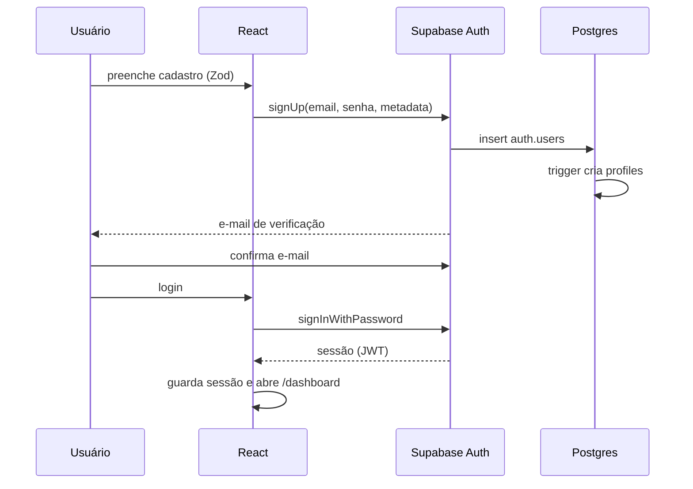
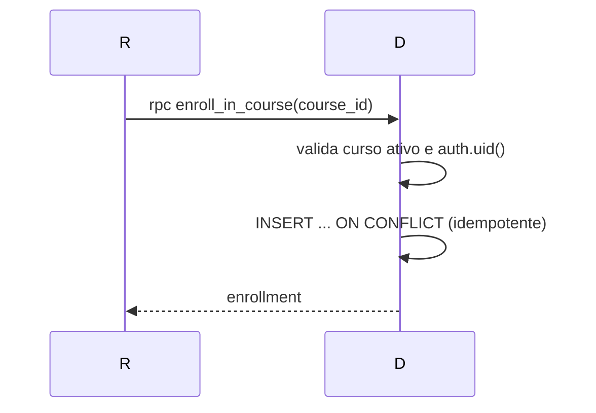
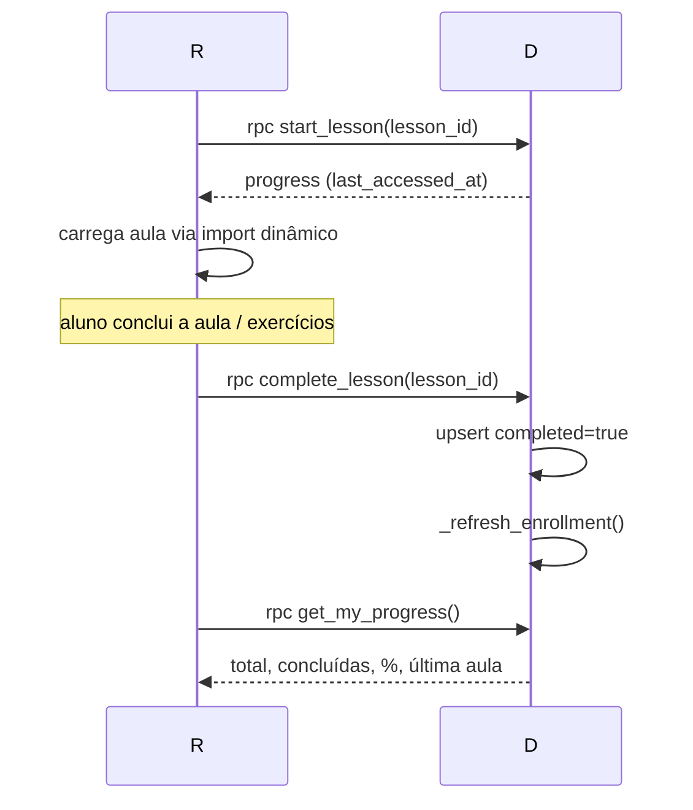
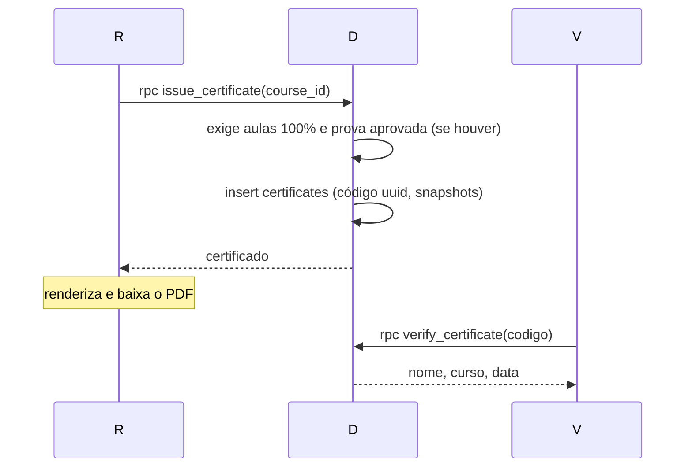

# Arquitetura

> Estado: banco, segurança, documentação e **frontend (React + Tailwind + JavaScript)** escritos. Nada foi executado em ambiente real ainda (ver README). O esboço original em PHP foi descartado: `login.php`/`register.php` viraram as páginas de Auth e `config/db.php` (conexão direta com a senha do banco) deixou de existir; o acesso ao banco agora é só via Supabase com a chave `anon` + RLS.

## Visão geral

```mermaid
flowchart TB
  subgraph Cliente
    R[React + Vite + JavaScript (JSX) + Tailwind<br/>React Router · TanStack Query · Zustand · Zod · Motion]
    C[src/courses/*<br/>aulas JS/JSX/CSS, lazy]
  end
  subgraph Vercel
    H[Hospedagem estática + rewrites SPA]
  end
  subgraph Supabase
    A[Auth]
    P[PostgREST]
    D[(PostgreSQL<br/>RLS + RPCs)]
  end
  H --> R
  R --> C
  R -- chave anon --> A
  R -- chave anon --> P
  P --> D
  A --> D
```

## Estrutura de pastas (proposta)

```text
.
├── docs/                       # esta documentação
├── supabase/
│   ├── migrations/             # SQL versionado
│   ├── tests/                  # pgTAP (RLS e regras)
│   └── seed.sql
├── public/                     # favicon
├── src/
│   ├── main.jsx  App.jsx       # providers (Query, MotionConfig, Router) e rotas
│   ├── lib/                    # supabase.js, schemas (Zod), errors, progress (funções puras)
│   ├── store/                  # authStore (Zustand: só a sessão)
│   ├── services/               # um módulo por domínio (único lugar que chama o Supabase)
│   ├── hooks/queries.js        # hooks do TanStack Query
│   ├── components/             # Layout, Navbar, Footer, CourseCard, ProgressBar, ClickDemo...
│   ├── pages/                  # Home, Register, Login, Dashboard, CourseDetail, Learn, Exam, Certificates...
│   └── courses/
│       ├── registry.js         # import.meta.glob + React.lazy por content_path
│       └── <slug>/<modulo>/<aula>/index.jsx   # = lessons.content_path
├── .env.example  vercel.json  tailwind.config.js  vite.config.js
```

**Integração dos cursos:** `LessonPage` recebe o `content_path` do banco e faz `import()` dinâmico de `src/courses/<content_path>/index.jsx` por meio de um mapa gerado com `import.meta.glob` (`src/courses/registry.js`) (o Vite exige caminho estático; um mapa evita montar caminhos arbitrários vindos do banco). Cada aula é um módulo com seu próprio JS/CSS e recebe `onComplete` (a aula de exemplo `informatica-basica/modulo-01/aula-01` chama quando o aluno explora tudo). Aulas ainda sem arquivo mostram um aviso de "conteúdo em preparação".

## Fluxos

### Autenticação



### Matrícula



### Aprendizagem e progresso



### Avaliação final

```mermaid
sequenceDiagram
  R->>D: select questões e alternativas (sem gabarito)
  R->>D: rpc submit_exam(exam_id, answers)
  D->>D: valida matrícula, aulas, tentativas (lock)
  D->>D: calcula nota com exam_answer_keys
  D->>D: grava exam_attempts; atualiza matrícula
  D-->>R: nota, aprovado, tentativas restantes
```

### Certificado



## Animações

Motion for React (`motion/react`), com `MotionConfig reducedMotion="user"` na raiz (respeita `prefers-reduced-motion`):

- entrada de página (fade + deslocamento curto) no `Layout`;
- troca de aula com `AnimatePresence mode="wait"`;
- barra de progresso animada, menu móvel, confirmação ao concluir aula e resultado da prova;
- um único momento animado na home (`ClickDemo`: o cursor dá o "primeiro clique").

Evitou-se animação em cada card. As skills transitions.dev e motion.dev não estavam disponíveis neste ambiente; foram usadas só APIs básicas e conhecidas de `motion/react`, que devem ser conferidas na primeira execução.

## Painel administrativo (preparação)

O banco já tem `user_roles`, `is_admin()` e policies de escrita para admin em catálogo, provas, gabarito e moderação de feedback. Falta apenas a interface.
