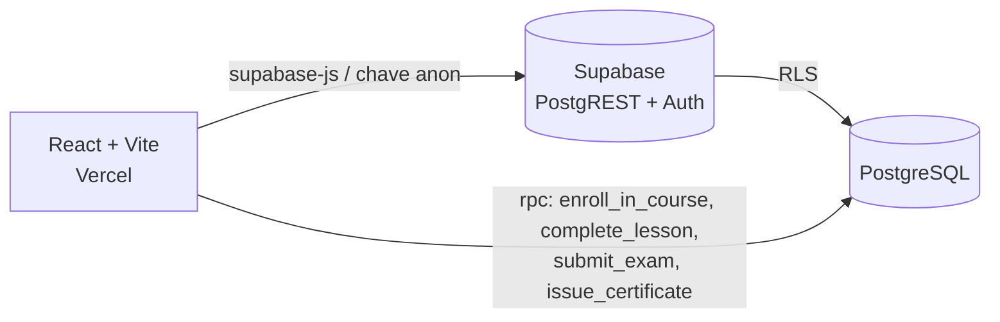

# Backend

## Visão geral

Não há servidor próprio. O "backend" é o **Supabase**:

- **Auth** (`auth.users`): cadastro, login, sessão JWT, recuperação de senha, e-mail de verificação.
- **PostgREST** (API gerada): o React lê tabelas direto com `supabase-js`; **RLS** decide as linhas.
- **RPCs PostgreSQL** (`SECURITY DEFINER`): toda escrita que tem regra de negócio.

### Por que RPCs em vez de Edge Functions?

O prompt pede Edge Functions ou Vercel Functions "quando houver necessidade de operações privilegiadas". As regras atuais (matrícula, progresso, correção, certificado) são transacionais e dependem só de dados do banco. Em SQL elas ficam atômicas, sem salto de rede e com `auth.uid()` confiável. **Nenhuma Edge Function é necessária hoje.** Passam a ser úteis para: geração de PDF no servidor, envio de e-mail, webhooks e rotinas agendadas.

## Autenticação

| Operação | Chamada |
|---|---|
| Cadastro | `supabase.auth.signUp({ email, password, options: { data: { name, surname, birth_date }, emailRedirectTo } })` → o trigger cria o `profiles`. |
| Login / logout | `signInWithPassword` / `signOut` |
| Recuperar senha | `resetPasswordForEmail(email, { redirectTo })` + tela que chama `updateUser({ password })` |
| Sessão | `getSession()` + `onAuthStateChange()` (um único listener, guardado no store Zustand) |

A verificação de e-mail depende de *Confirm email* ligado no painel (ver `README.md`).

## Serviços (frontend)

Cada módulo em `src/services/` encapsula chamadas ao Supabase; componentes nunca chamam `supabase` direto, usam hooks do TanStack Query.

| Serviço | Faz |
|---|---|
| `authService` | signUp, signIn, signOut, reset, sessão, perfil |
| `courseService` | cursos ativos, detalhe por `slug`, módulos e aulas |
| `enrollmentService` | `rpc('enroll_in_course')`, listar matrículas |
| `progressService` | `rpc('start_lesson')`, `rpc('complete_lesson')`, `rpc('get_my_progress')` |
| `examService` | ler prova (sem gabarito), `rpc('submit_exam')`, tentativas |
| `certificateService` | `rpc('issue_certificate')`, listar, `rpc('verify_certificate')` |
| `feedbackService` | inserir, listar `public_feedbacks` |

## Progresso

- `start_lesson` (ao abrir a aula) faz *upsert* de `last_accessed_at` → alimenta "continuar de onde parou".
- `complete_lesson` faz *upsert* com `completed = true`; chamar duas vezes não duplica nem muda `completed_at`.
- `get_my_progress` calcula, **por consulta**, aulas ativas × concluídas e a última aula. Nada de percentual armazenado.
- Quando todas as aulas ativas estão concluídas **e** (não há prova ativa **ou** há tentativa aprovada), a matrícula vira `completed`.

## Avaliações

1. O aluno lê questões e alternativas (sem gabarito; ele não tem acesso a `exam_answer_keys`).
2. Envia `{ "<question_id>": "<option_id>" }` para `submit_exam`.
3. O servidor valida: autenticado, matriculado, **todas as aulas concluídas**, sem aprovação anterior, tentativas restantes (com *lock* na matrícula para evitar corrida), prova configurada.
4. Calcula `score = 100 × pontos acertados / pontos totais`, grava a tentativa e devolve `{ attempt_no, final_score, is_approved, attempts_left }`. O gabarito nunca sai do banco.

## Certificados

`issue_certificate(course_id)` exige matrícula, aulas concluídas e requisito de prova cumprido; só então insere (com *snapshot* do nome do aluno e do curso) e devolve o certificado. É idempotente: chamar de novo devolve o mesmo. A página pública `/validar/:codigo` usa `verify_certificate(code)`, que devolve só nome, curso e data. O PDF é gerado **no navegador** a partir desses dados (ou em Edge Function, se um dia for necessário assinatura/arquivo oficial).

## Erros de negócio

As RPCs levantam mensagens curtas que o frontend mapeia para texto amigável: `not_authenticated`, `not_enrolled`, `course_not_available`, `lesson_not_found`, `lessons_incomplete`, `exam_not_passed`, `already_approved`, `max_attempts_reached`, `invalid_answers`, `exam_misconfigured`, `exam_not_found`.

## Exercícios

`exercises`/`exercise_attempts` são **formativos**. O resultado é calculado pelo JavaScript da aula no navegador e, portanto, não é confiável; `record_exercise_attempt` só registra, e nada disso influencia aprovação ou certificado. Notas oficiais existem apenas na avaliação final.
