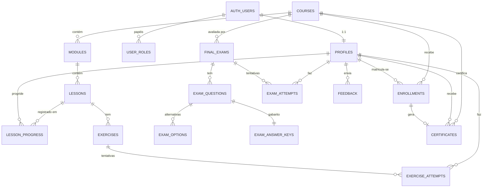

# Banco de dados

PostgreSQL gerenciado pelo Supabase. Fonte da verdade: `supabase/migrations/`.
Convenções: PK `uuid` (`gen_random_uuid()`), datas `timestamptz`, `updated_at` mantido por trigger.

## Diagrama (ER)



## Tabelas

Abaixo, só o essencial de cada uma; os tipos exatos estão nas migrations.

| Tabela | Para quê | Pontos-chave |
|---|---|---|
| `profiles` | Dados complementares do aluno | `id` = `auth.users.id` (CASCADE). `name`, `surname`, `birth_date` (do README), `avatar_url`. Senha **nunca** aqui. |
| `user_roles` | Permissões administrativas | PK `(user_id, role)`, `role in ('admin')`. Sem escrita pelo cliente. |
| `courses` | Catálogo | `slug` único e validado por regex; `is_active`; `duration_minutes >= 0`. |
| `modules` | Módulos do curso | `UNIQUE(course_id, order_index)` *deferrable* (permite reordenar). |
| `lessons` | Aulas | `content_path` aponta para `src/courses/<content_path>`; regex bloqueia `..` e `/` inicial; `UNIQUE(module_id, order_index)`. |
| `enrollments` | Aluno × curso | `UNIQUE(student_id, course_id)`; `status in (active, completed, cancelled)`; `completed_at` coerente com `status`. |
| `lesson_progress` | Progresso por aula | `UNIQUE(student_id, lesson_id)`; `completed ⇒ completed_at`. |
| `exercises` | Exercícios da aula | `exercise_type` restrito a uma lista. |
| `exercise_attempts` | Tentativas formativas | `answer jsonb`; `score 0–100`. Não conta para aprovação. |
| `final_exams` | Avaliação final | `passing_score 0–100`, `max_attempts > 0`; índice único parcial: **uma prova ativa por curso**. |
| `exam_questions` | Questões | `points > 0`. *(extra ao prompt)* |
| `exam_options` | Alternativas | Sem campo de gabarito. `UNIQUE(id, question_id)`. *(extra)* |
| `exam_answer_keys` | Gabarito | FK composta `(option_id, question_id)` garante que a correta pertence à questão. Alunos não têm acesso. *(extra)* |
| `exam_attempts` | Tentativas da prova | `UNIQUE(exam_id, student_id, attempt_number)`; `score`, `approved` só gravados pela RPC. |
| `certificates` | Certificados | `certificate_code` uuid único; `UNIQUE(student_id, course_id)` e `UNIQUE(enrollment_id)`; snapshots `student_name` e `course_name`. |
| `feedback` | Avaliações da plataforma | `rating 1–5`; `message ≤ 2000`; `is_public` (moderação; só admin liga). |

### Desvios em relação ao prompt (e por quê)

1. **`exam_questions`, `exam_options`, `exam_answer_keys`**: o prompt pede correção no servidor, o que exige guardar questões e gabarito em algum lugar. O gabarito fica em tabela separada porque RLS filtra linhas, não colunas.
2. **`user_roles`**: mecanismo de admin que o usuário não consegue editar.
3. **`certificates.enrollment_id`** (+ snapshots): o prompt exige unicidade "por matrícula", que só é possível com essa coluna.
4. **`exam_attempts.attempt_number`**: torna o limite de tentativas seguro contra requisições simultâneas.
5. **`profiles.birth_date`** e **`feedback.is_public`**: vêm do README (cadastro com data de nascimento; feedbacks visíveis no site).

## Chaves estrangeiras e exclusão

- **Estrutura** (`modules`, `lessons`, `exercises`, `exam_*`): `ON DELETE CASCADE` a partir do curso/aula/prova.
- **Histórico acadêmico** (`enrollments`, `lesson_progress`, `exercise_attempts`, `exam_attempts`, `certificates`): `ON DELETE RESTRICT`. Como `lesson_progress → lessons` é RESTRICT, **não dá para apagar uma aula/curso que já tem histórico**: desative com `is_active = false`.
- `feedback.student_id`: `SET NULL` (o comentário sobrevive, anônimo).
- `profiles → auth.users`: CASCADE, mas, havendo histórico, a remoção do usuário é barrada pelos RESTRICT acima. Para atender a um pedido de exclusão (LGPD) será necessária uma rotina de anonimização — ver "Pendências" em `security.md`.

## Índices

FKs consultadas com frequência têm índice (`idx_*`). Destaques: `lesson_progress (student_id, last_accessed_at desc)` para "última aula acessada"; índice parcial de feedbacks públicos; índice único parcial da prova ativa.

## Funções, views e triggers

| Objeto | Função |
|---|---|
| trigger `on_auth_user_created` → `handle_new_user()` | Cria o `profiles` a partir do metadata do cadastro. |
| `set_updated_at()` | Atualiza `updated_at`. |
| `is_admin()`, `has_course_access()` | Usadas pelas policies. |
| `enroll_in_course`, `start_lesson`, `complete_lesson`, `get_my_progress`, `record_exercise_attempt`, `submit_exam`, `issue_certificate`, `verify_certificate` | RPCs de negócio (ver `backend.md`). |
| `_course_lessons_completed`, `_exam_requirement_met`, `_refresh_enrollment`, `_lesson_course` | Helpers internos, sem EXECUTE para clientes. |
| view `public_feedbacks` | Feedbacks moderados, com só o primeiro nome do autor. |

## Exemplos de registros

```text
courses          {slug:'informatica-basica', name:'Informática Básica', duration_minutes:21, is_active:true}
modules          {course:'informatica-basica', title:'Teclado e mouse', order_index:2}
lessons          {title:'Aula 1 · Teclado e mouse', content_path:'informatica-basica/modulo-02/aula-01', order_index:1}
enrollments      {student:<uuid>, course:<uuid>, status:'active', completed_at:null}
lesson_progress  {student:<uuid>, lesson:<uuid>, completed:true, completed_at:'2026-11-10T20:01:00Z'}
exam_attempts    {attempt_number:1, answers:{"<question_id>":"<option_id>"}, score:50.00, approved:false}
certificates     {certificate_code:'7b1f…', student_name:'Ana A', course_name:'Informática Básica'}
```
